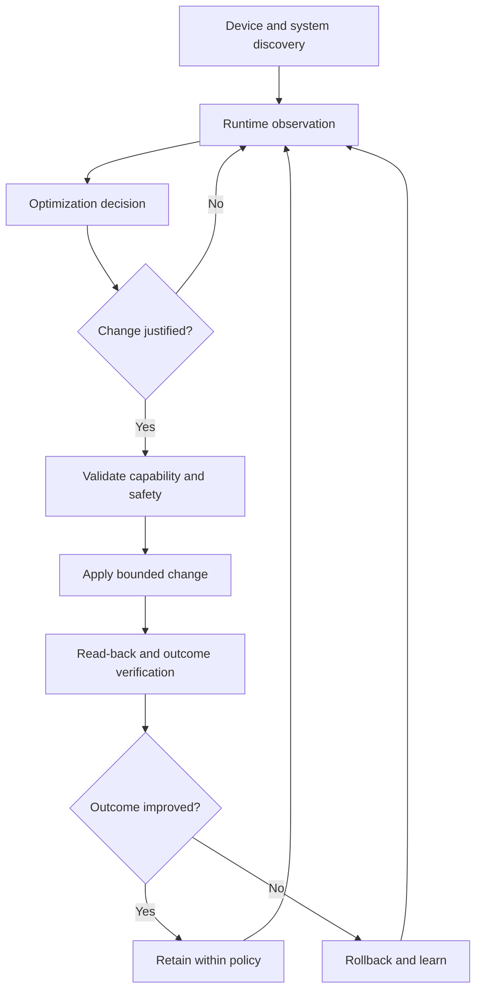

# Umbrella Kernel — Architecture

## Responsibilities

**Umbrella Kernel**: kernel mechanisms, device drivers, scheduler, memory, storage/I/O, power/thermal safeguards, and hardware-facing controls.

**CoreFlow Autonomous Engine**: userspace observation, baseline measurement, candidate evaluation, capability detection, bounded control, read-back verification, outcome assessment, and rollback.

**Umbrella–CoreFlow integration**: optional runtime-discovered cooperation; it must never be required for normal kernel boot or device safety.

## System control flow

## Design invariants

1. Kernel is fully functional without CoreFlow; no userspace daemon is part of the boot safety path.
2. CoreFlow remains operable with other compatible Android kernels.
3. The kernel retains ultimate authority over thermal, hardware and integrity protection.
4. Use supported Linux/Android interfaces before introducing private ABI or sysfs controls.
5. Capability support is discovered at runtime, not inferred from marketing names or hardcoded paths.
6. Each mutation has bounds, permission checks, observed read-back, measurable attribution, and rollback where feasible.
7. A successful register/file write is **not** evidence of improved user experience.
8. Kernel patches must be testable independently from CoreFlow policies.

## Performance domains

- Responsiveness: latency distributions for wakeup, scheduling and app launch.
- Rendering: frame pacing and tail latency; actual rendering is coordinated across framework, graphics stack, GPU driver and apps, not kernel alone.
- Memory: reclaim stalls and PSI, swap/ZRAM behavior, memory pressure.
- Storage: I/O latency and queue behavior, with safe filesystem and device compatibility.
- Efficiency: measured thermal/power behavior and regression monitoring.

## Integration boundaries

See `interfaces/coreflow-capabilities.v0.example.json` for a **design example**, not a kernel ABI or live capability discovery endpoint. A transport/protocol will be selected only after validating a practical requirement. Never silently expose privileged writes to arbitrary applications.
